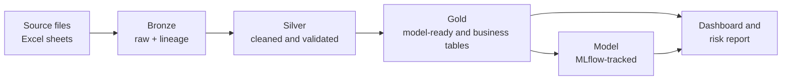
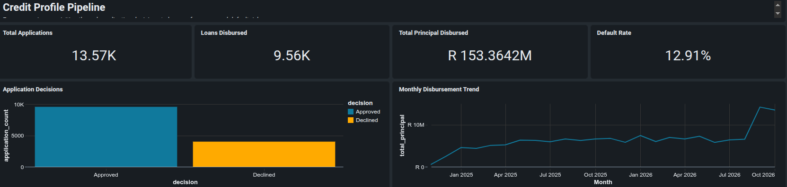
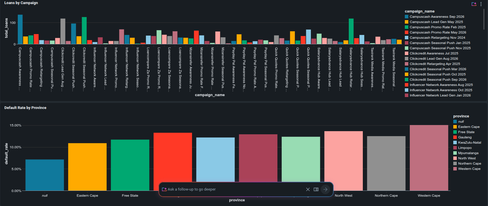
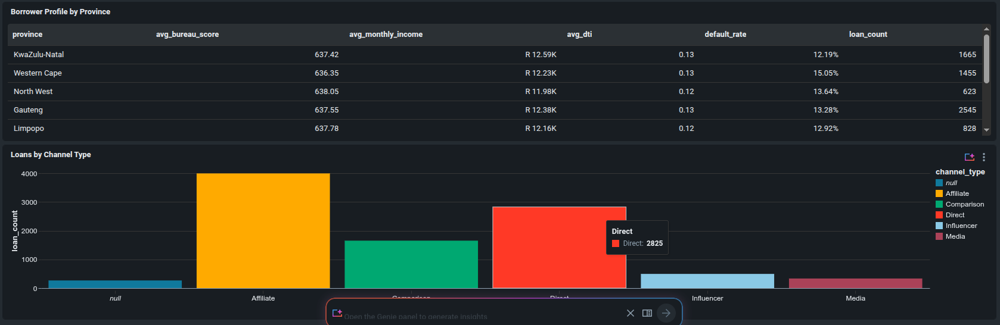

# Credit Risk Pipeline: South African Lender on Databricks

An end-to-end credit-risk project built on Databricks: messy source files are ingested, cleaned and validated through a bronze/silver/gold lakehouse, turned into a model-ready loan table, and used to train default-prediction models tracked in MLflow. The results feed a written risk report and a [portfolio risk dashboard](https://dbc-6c4cb454-75d3.cloud.databricks.com/dashboardsv3/01f1d37289f81ae5a64c077cede169e6/published?o=7474644303483899).

> **Note:** all data is simulated. It is designed to behave like a South African consumer lender's portfolio, including the data quality problems found in real source systems.

---

## The business question

A lender approves loans through partner channels and marketing campaigns. It needs to know:

1. **Which applicants are likely to default?** A model that ranks new applicants by risk at the point of application.
2. **Where is the portfolio risk concentrated?** Default rates by segment, channel and time.
3. **Which campaigns are worth the money?** Cost per application and cost per approved loan.

---

## Results at a glance

| Metric | Value |
|---|---|
| Loans in the gold table | 9,564 |
| Matured (labelled) loans | 6,276 |
| Default rate (matured loans) | 19.7% |
| Test set (time-based holdout) | 1,256 loans |
| Best model | Logistic regression |
| Test AUC / Gini | **0.668 / 0.336** |

| Model | Test AUC | Test Gini |
|---|---|---|
| Logistic regression | 0.668 | 0.336 |
| Gradient boosting (HistGradientBoosting) | 0.626 | 0.253 |

Logistic regression outperformed gradient boosting on the holdout. With around 5,000 training loans, the more flexible model overfits slightly, while logistic regression generalises better. It is also the model lenders usually prefer, because each feature's effect can be explained to regulators and credit committees.

---

## Architecture



| Layer | What happens | Tables |
|---|---|---|
| **Bronze** | Source files loaded as-is, with lineage columns (source file, sheet, ingestion time) | `customers`, `applications`, `loans`, `repayments`, `partners`, `campaigns` |
| **Silver** | IDs standardised, money, numbers and dates parsed, categories mapped, out-of-range values nulled, duplicates removed, quality checks enforced | same six tables, cleaned |
| **Gold** | One row per loan with application-time features and a default label, plus campaign attribution and efficiency | `loan_table`, `application_campaign`, `campaign_efficiency` |
| **Model** | Time-based train/test split, two models compared, metrics and models logged to MLflow | MLflow experiment `credit_risk_model` |

The whole pipeline runs from one notebook, `00_run_all`, which executes each stage in order and prints a summary of the gold table and the latest model results.

---

## Data quality

The simulated source data contains the kinds of problems real lending data has, and the silver layer deals with each of them explicitly.

| Problem in the source | How it is handled |
|---|---|
| IDs written as `c00042`, `C 0042`, `42` | `clean_id` standardises them, e.g. to `C00042` |
| Money as `R 7350`, `R7,350`, `7350.00` | `parse_money` strips currency symbols, spaces and commas |
| Dates in seven different formats, some with two-digit years | `parse_date` tries each format and rejects dates outside a valid range |
| Null markers such as `N/A`, `ND`, `unknown`, `-` | Treated as missing by a single shared pattern |
| Free-text categories (`gau`, `Gauteng`, `GAUTENG`) | Mapped to standard values; ambiguous values (e.g. `Nor`) are reported and left blank rather than guessed |
| Exact duplicate rows | Removed and counted |
| Campaign start and end dates swapped, negative spend | Corrected and flagged |

Every silver table must pass checks before it is written:

- **Uniqueness:** each key appears once (`assert_unique`).
- **Date parsing:** no source date left unparsed (`unparsed_dates`).
- **Referential integrity:** applications have customers, loans have applications, and repayments have loans (`orphans`).
- **Null report:** the percentage of missing values per column is printed on every run.

The cleaning functions live in `src/cleaning.py` and the checks in `src/quality.py`, so every notebook uses the same logic. The cleaning module includes unit tests for the trickiest formats (partner IDs and campaign spend).

---

## Key modelling decisions

**Application-time features only.** Every feature in the loan table is something the lender would know when the application arrived, such as income, bureau score, loan terms and the number of previous applications. This prevents the model from "seeing the future". For example, `n_prior_applications` counts only applications made *before* the current one.

**A clear default definition.** A loan counts as defaulted if it reaches **90+ days past due within its first 6 instalments**, or within the full term for shorter loans.

**Only fully observed loans are labelled.** Loans that have not yet been observed for the whole 6-instalment window get no label and are excluded from training. Keeping recent loans that have already defaulted, while dropping those that have not yet had time to, would make recent cohorts look riskier than they are.

**A time-based split.** Loans are sorted by application date. The model trains on the oldest 80% and is tested on the newest 20%. This mirrors how a lender would use the model: trained on past customers and applied to future ones.

**Fair-lending considerations.** Sex is deliberately excluded as a feature. The National Credit Act prohibits unfair discrimination in credit decisions, and a production scorecard would not use it.

**Campaign attribution.** Each application is linked to the campaign running for its partner on its application date. Where campaigns overlap, the most recently started campaign gets the credit. A check confirms that attribution never adds or loses applications.

### Features used

| Type | Features |
|---|---|
| Loan terms | principal, term (months), interest rate |
| Affordability | monthly income, debt-to-income (instalment ÷ income), loan-to-income |
| Credit history | bureau score, no-bureau-hit flag, number of prior applications |
| Applicant | age at application, employment duration, employer type, province |
| Channel | partner channel type |

Missing numeric values are filled with the training median, numeric features are standardised, and categories are one-hot encoded, all inside a scikit-learn pipeline so the same steps apply at prediction time.

---

## Dashboard

**[View the live dashboard on Databricks](https://dbc-6c4cb454-75d3.cloud.databricks.com/dashboardsv3/01f1d37289f81ae5a64c077cede169e6/published?o=7474644303483899)**

The dashboard is built on the gold tables and gives a credit manager a one-page view of the portfolio.

**Portfolio overview:** total applications, loans disbursed, principal lent and default rate, with approval decisions and the monthly disbursement trend.



**Campaigns and provinces:** loans brought in by each marketing campaign, and default rate by province.



**Borrower profile and channels:** average bureau score, income, debt-to-income and default rate per province, and loan volume by partner channel.



---

## Repository structure

```
credit_risk_pipeline/
├── 00_run_all          # runs the full pipeline and prints a summary
├── 01_bronze           # ingests source files with lineage columns
├── 02_silver           # cleans and validates each table
├── 03_gold             # builds the loan table and campaign tables
├── 04_model            # trains and evaluates models, logs to MLflow
└── src/
    ├── cleaning.py     # shared cleaning functions and value mappings
    └── quality.py      # shared data quality checks
```

---

## How to run it

1. Use **Databricks** (the Free Edition works).
2. Clone this repository into a **Git folder** in your workspace.
3. Update the workspace path in the `sys.path.append(...)` lines if your Git folder is in a different location.
4. Upload the source files and point `01_bronze` at them.
5. Open `00_run_all` and click **Run all**.

The final cell prints the gold table summary and the AUC and Gini of the latest models. Full run details are in **Experiments → credit_risk_model** in the Databricks sidebar.

---

## Tech stack

**Databricks** · **PySpark** · **Delta Lake** · **SQL** · **Python** (pandas, scikit-learn) · **MLflow** · **Databricks AI/BI** · **Git / GitHub**

---

## Limitations and next steps

- **Simulated data:** results show the method, not the performance on a real portfolio.
- **Moderate predictive power:** a Gini of 0.34 is a reasonable start. Next steps are feature engineering, hyperparameter tuning and comparing a binned (WoE) scorecard.
- **Calibration:** check that predicted default probabilities match observed default rates, which matters for pricing and provisioning.
- **Orchestration:** schedule `00_run_all` as a Databricks job, and add monitoring for data drift and model performance over time.

---

## Author

**Devon-Lee Allies** · [LinkedIn](https://linkedin.com/in/devonallies) · [GitHub](https://github.com/DevonAllies) · [Portfolio](https://devonallies.github.io/DataAnalysisPortfolio)